# RESTAURANT & CAFE POS SYSTEM (F&B ENTERPRISE SOLUTION)

Production-grade, multi-platform Point of Sale (POS), Floor Map, and Table-Service Management System engineered for modern restaurants and cafes. Built as an offline-resilient monorepo comprising a Flutter mobile client with on-device SQLite persistent caching, backed by an ASP.NET Core 10 RESTful API and Microsoft SQL Server.

---

## 1. TONG QUAN KIEN TRUC HE THONG (SYSTEM ARCHITECTURE)

He thong hoat dong theo kien truc 4 tang (4-tier provider/repository architecture) ket hop Offline-First phan phoi cao, dam bao van hanh lien tuc ngay ca khi mat ket noi mang Internet.

```
+---------------------------------------------------------------------------------+
|                       MOBILE CLIENT (FLUTTER 3.47 / DART 3.13)                  |
|  - Presentation Layer: FloorTablePage, CashierPosTerminal, KDS, MemberPortal   |
|  - Local Storage (SQLite): user_session, cart_items, offline_orders queue       |
|  - Service Layer: OfflineSyncService (Auto sync), ReceiptPrinterService         |
|  - Repository Layer: TableRepository, OrderRepository, ProductRepository        |
+---------------------------------------------------------------------------------+
                                       |
                                       | RESTful JSON over HTTP / HTTPS
                                       v
+---------------------------------------------------------------------------------+
|                    BACKEND REST API (ASP.NET CORE 10 WEB API)                   |
|  - Presentation: AuthController, TableController, OrderController, Product, etc |
|  - Facade Layer: SiteProvider / BaseProvider                                    |
|  - Data Access Layer: AccountRepo, TableRepo, OrderRepo, ProductRepo, etc.      |
|  - Security & Storage: JWT Bearer, SHA-256 Salted Hashing, wwwroot/images       |
+---------------------------------------------------------------------------------+
                                       |
                                       | Entity Framework Core 10
                                       v
+---------------------------------------------------------------------------------+
|                     CENTRAL DATABASE (MICROSOFT SQL SERVER)                     |
|  - 10 Bang chuan hoa 3NF: Roles, Accounts, Areas, DiningTables, Categories,     |
|    Products, ProductAttributes, Orders, OrderDetails, Payments                  |
+---------------------------------------------------------------------------------+
```

---

## 2. CONG NGHE SU DUNG (TECHNOLOGY STACK)

| Thanh phan | Cong nghe | Phien ban | Muc dich su dung |
| :--- | :--- | :--- | :--- |
| Mobile Client | Flutter / Dart SDK | Flutter 3.47.1 / Dart 3.13.1 | Ung dung POS cam tay cho Phuc vu, Thu ngan, Bep va Khach hang |
| Local Database | SQLite (sqflite) | 2.4.2 | Luu tru offline gio hang, phien dang nhap va hang doi dong bo |
| Backend API | ASP.NET Core Web API | .NET 10.0 (net10.0) | Xu ly nghiep vu tap trung, giao dich ACID va REST controllers |
| ORM | Entity Framework Core | 10.0.12 | Anh xa doi tuong quan he voi SQL Server |
| Database | Microsoft SQL Server | 2019 / 2022 | Co so du lieu quan he trung tam (10 bang chuan hoa 3NF) |
| Payment Gateway | VietQR / VNPayment | NAPAS 247 / v2 | Thanh toan ma QR dong ngan hang va cong thanh toan truc tuyen |

---

## 3. SO DO LUONG NGHIEP VU TOAN BO PROJECT (SYSTEM PROCESS FLOW)

So do duoi day mo ta toan bo chu trinh van hanh tu khi khach vao ban, nhan vien order, bep che bien, thu ngan thanh toan den dong bo ngoai tuyen:

```mermaid
flowchart TD
    Start(["Khach hang den nha hang"]) --> TableSelect["Chon ban tren So do phong an (Floor Map)"]
    
    subgraph RoleEntry ["Phan quyen & Vai tro nguoi dung"]
        AdminRole["ADMIN / MANAGER: Toan quyen, Thong ke, Quan ly ban & mon"]
        WaiterRole["WAITER: Mo ban, Chon mon, Chuyen ban, Gui order"]
        KitchenRole["KITCHEN: Nhan order KDS, Bao het mon, Cap nhat che bien"]
        CashierRole["CASHIER: In hoa don, Chiet khau, Tach/Gop bill, Thu tien"]
        MemberRole["MEMBER: Tu dat mon QR tai ban, Tra cuu don, Doi diem voucher"]
    end

    TableSelect --> Ordering["Chon mon an tu Thuc don (Size, Topping, Ghi chu)"]
    Ordering --> Cart["Them vao Gio hang (SQLite Local Cache)"]
    
    Cart --> NetCheck{"Kiem tra ket noi mang?"}
    NetCheck -- "Online" --> ApiOrder["Goi POST /api/order len Backend"]
    NetCheck -- "Offline" --> LocalQueue["Luu vao offline_orders queue trong SQLite"]
    LocalQueue --> SyncDaemon["OfflineSyncService tu dong dong bo khi co mang"]
    SyncDaemon --> ApiOrder

    ApiOrder --> TableStatusOcc["Cap nhat ban: CO KHACH (Occupied)<br/>Khoi dong Bo dem thoi gian ngoi (Seating Timer)"]
    TableStatusOcc --> KDSQueue["Order chuyen xuong Man hinh bep (KDS)"]

    subgraph KitchenFlow ["Nghiep vu Che bien tai Bep (KDS)"]
        KDSQueue --> Alert["Bao chuong Alert + Rung Haptic khi co order moi"]
        Alert --> CookingStatus{"Trang thai mon an"}
        CookingStatus -- "Nguyen lieu san sang" --> CookStep["Che bien: Cho nau -> Dang nau -> Hoan thanh"]
        CookingStatus -- "Het nguyen lieu / Khach doi y" --> VoidStep["Huy mon (Void Item) kem ly do va ghi chu"]
        VoidStep --> RefundCalc["Tu dong giam tong tien order va thong bao thu ngan"]
        CookStep --> ReadyServe["Mon da san sang: Phuc vu mang ra ban"]
    end

    ReadyServe --> BillRequest["Khach yeu cau tinh tien"]
    
    subgraph CashierFlow ["Nghiep vu Thu ngan & Thanh toan"]
        BillRequest --> CashierAction["Thu ngan kiem tra hoa don tren POS"]
        CashierAction --> DiscountOption{"Co ap dung giam gia khong?"}
        DiscountOption -- "Co" --> ApplyDiscount["Giam gia thu cong (% hoac VND) hoac Ap dung Voucher"]
        DiscountOption -- "Khong" --> ChoosePaymentMethod
        ApplyDiscount --> ChoosePaymentMethod{"Chon phuong thuc thanh toan"}

        ChoosePaymentMethod -- "Tien mat (Cash)" --> CashPay["Nhap tien khach dua -> Tinh tien thoi"]
        ChoosePaymentMethod -- "Chuyen khoan VietQR" --> QRPay["Sinh ma VietQR dong NAPAS 247 theo so tien"]
        ChoosePaymentMethod -- "Cong VNPay Sandbox" --> VNPay["Chuyen huong cong thanh toan VNPay"]
        ChoosePaymentMethod -- "Thanh toan hon hop (Split)" --> SplitPay["Chia thanh toan: Mot phan Tien mat + Mot phan VietQR"]

        CashPay --> ConfirmPay["POST /api/payment/confirm"]
        QRPay --> ConfirmPay
        VNPay --> ConfirmPay
        SplitPay --> ConfirmPay

        ConfirmPay --> PrintReceipt["In hoa don nhiet 80mm<br/>(In lai danh dau DUPLICATE chong gian lan)"]
        PrintReceipt --> ReleaseTable["Cap nhat ban: TRONG (Available) & Ket thuc don"]
    end

    ReleaseTable --> End(["Hoan tat quy trinh phuc vu"])
```



---

## 4. SEQUENCE DIAGRAM CHI TIET TOAN BO QUY TRINH (END-TO-END FLOW)

So do trinh tu the hien tuong tac chi tiet giua cac Actor, Ung dung di dong, SQLite, Backend REST API, Database va Cong thanh toan:


---

## 5. DANH SACH TAI KHOAN VA MAT KHAU THEO TUNG VAI TRO (RBAC SEEDED ACCOUNTS)

He thong ho tro phan quyen chat che theo Role-Based Access Control (RBAC). Toan bo tai khoan mau duoi day da duoc nap san trong file co so du lieu `RestaurantPosDb.sql` va `RestaurantPos_Acceptance.sql`:

* Luu y ve mat khau: Toan bo tai khoan ben duoi co mat khau mac dinh la: `admin` (chuoi bam SHA-256 luu trong database: `8c6976e5b5410415bde908bd4dee15dfb167a9c873fc4bb8a81f6f2ab448a918`).

| STT | Ten dang nhap (Username) | Mat khau mac dinh | Ma vai tro (Role) | Ten vai tro | Ho va ten | Email | Quyen han & Pham vi nghiep vu |
| :---: | :--- | :--- | :--- | :--- | :--- | :--- | :--- |
| 1 | `admin` | `admin` | `ADMIN` | Quan tri vien | Nguyen Van Quan Tri | `admin@restaurantpos.vn` | Toan quyen: Cau hinh he thong, quan tri danh muc, mon an, nhan su, bao cao doanh thu |
| 2 | `manager01` | `admin` | `MANAGER` | Quan ly | Tran Thi Thu Quan Ly | `manager01@restaurantpos.vn` | Quan ly van hanh: Dieu phoi ban, huy mon co giam sat, kiem soat ca, bao cao |
| 3 | `cashier_mai` | `admin` | `CASHIER` | Thu ngan | Le Tuyet Mai | `mai.cashier@restaurantpos.vn` | Thu ngan POS: Lap hoa don, tach bill, chiet khau, thu tien mat, VietQR, in lai hoa don |
| 4 | `waiter_nam` | `admin` | `WAITER` | Phuc vu | Pham Hoang Nam | `nam.waiter@restaurantpos.vn` | Phuc vu ban: Mo ban tren so do, chon mon, chuyen ban, theo doi thoi gian ngoi |
| 5 | `waiter_lan` | `admin` | `WAITER` | Phuc vu | Do Ngoc Lan | `lan.waiter@restaurantpos.vn` | Phuc vu ban: Tai khoan thu 2 phuc vu kiem thu thao tac dong thoi va ban giao ca |
| 6 | `kitchen` | `admin` | `KITCHEN` | Bep truong KDS | Bep Truong KDS | `kitchen@restaurantpos.vn` | Man hinh KDS: Tiep nhan mon, cap nhat tien do nau, bao het mon (Sold-Out Toggle) |
| 7 | `chef_dung` | `admin` | `HEAD_CHEF` | Dau bep chinh | Ngo Tien Dung | `dung.chef@restaurantpos.vn` | Dau bep: Che bien cac mon an chinh, mon nong va kiem soat chat luong mon |
| 8 | `barista_tuan` | `admin` | `BARISTA_LEAD` | Truong quay Bar | Vu Anh Tuan | `tuan.barista@restaurantpos.vn` | Quay pha che: Chuyen trach pha che ca phe, tra trai cay, da xay, do uong |
| 9 | `member_khang` | `admin` | `MEMBER` | Hoi vien | Bui Vinh Khang | `khang.bui@gmail.com` | Khach hang than thiet: Tu goi mon QR tai ban, tich luy diem, doi voucher giam gia |
| 10 | `vip_huong` | `admin` | `VIP_MEMBER` | Hoi vien VIP | Dang Thu Huong | `huong.dang@fpt.com` | Hoi vien VIP: Huong dac quyen chiet khau VIP khi lap hoa don va voucher cao cap |
| 11 | `member_linh` | `admin` | `MEMBER` | Hoi vien | Vo Dieu Linh | `linh.vo@outlook.com` | Khach hang than thiet tao qua lien ket mang xa hoi One-Tap OAuth |

---

## 6. DANH MUC REST API ENDPOINTS CHINH (API REFERENCE)

### 6.1. Xac thuc & Nguoi dung (Auth & Accounts)
* `POST /api/auth/login`: Dang nhap he thong bang username/password, tra ve JWT Token.
* `POST /api/auth/oauth-login`: Dang nhap mot cham qua Google hoac Facebook.
* `POST /api/auth/request-otp`: Yeu cau gui ma OTP 6 chu so qua email de dat lai mat khau.
* `POST /api/auth/reset-password-otp`: Xac nhan OTP va thiet lap mat khau moi.
* `POST /api/auth/change-password`: Doi mat khau (yeu cau token xac thuc).
* `GET /api/account/members`: Danh sach nhan vien va phan quyen (chi ADMIN va MANAGER).

### 6.2. So do ban & Khu vuc (Floor & Table Management)
* `GET /api/table`: Lay toan bo danh sach ban kem thoi gian ngoi va tam tinh realtime.
* `GET /api/table/areas`: Lay danh sach khu vuc (Tang tret, Tang 1, San vuon, Phong VIP).
* `POST /api/table`: Them ban an moi (ADMIN / MANAGER).
* `PUT /api/table/{id}`: Cap nhat thong tin ban an.
* `DELETE /api/table/{id}`: Xoa ban an (chan xoa neu ban dang co khach hoac chua thanh toan).
* `POST /api/table/area`: Them khu vuc moi.
* `PUT /api/table/{id}/status`: Doi trang thai ban (0: Trong, 1: Co khach, 2: Da dat).
* `POST /api/table/transfer`: Chuyen ban tu ban nguon sang ban dich an toan.

### 6.3. Thuc don & San pham (Menu & Product Management)
* `GET /api/category`: Lay danh sach danh muc thuc don hoat dong.
* `POST /api/category`: Them danh muc moi kem upload anh.
* `PUT /api/category/{id}`: Cap nhat danh muc.
* `DELETE /api/category/{id}`: Xoa danh muc (chan xoa neu con san pham truc thuoc).
* `GET /api/product`: Lay danh sach mon an kem phan trang va tim kiem.
* `POST /api/product`: Them mon an moi kem upload anh vao `wwwroot/images`.
* `PUT /api/product/{id}`: Cap nhat thong tin va hinh anh mon an.
* `PUT /api/product/{id}/toggle-availability`: 1-Cham bat/tat trang thai con mon hoac het mon.

### 6.4. Don hang & Bep KDS (Orders & Kitchen)
* `POST /api/order`: Tao don hang moi tu Mobile Client.
* `GET /api/order`: Danh sach don hang, loc theo SĐT khach hang hoac trang thai.
* `GET /api/order/{id}`: Lay chi tiet don hang, danh sach mon va trang thai thanh toan.
* `PUT /api/order/{id}/status`: Cap nhat trang thai don (0: Moi, 1: Dang che bien, 2: Phuc vu, 3: Hoan tat).
* `POST /api/order/{id}/void-item`: Huy mon kem ly do, tu dong tru tien va ghi nhan kiem toan.

### 6.5. Thanh toan (Payments)
* `POST /api/payment/confirm`: Xac nhan thanh toan (Tien mat, VietQR, VNPay, Split).
* `POST /api/payment/vietqr`: Tao du lieu ma QR chuyen khoan NAPAS 247 dong.
* `GET /api/payment/vnpay/callback`: Tiep nhan IPN callback tu cong VNPay Sandbox.

---

## 7. HUONG DAN CAI DAT VA SETUP .ENV NHANH (QUICK SETUP GUIDE)

### 7.1. Yeu cau he thong truoc khi cai dat
* .NET SDK: Phien ban 10.0 (`dotnet --version` tra ve `10.0.x`)
* Flutter SDK: Phien ban 3.47 (`flutter --version` tra ve `3.47.x`, Dart `3.13.x`)
* Co so du lieu: Microsoft SQL Server 2019 / 2022 (hoac SQL Server Express)
* Git

---

### 7.2. Thiet lap Co so du lieu SQL Server

Mo cong cu SSMS (SQL Server Management Studio) hoac `sqlcmd` chay script khoi tao:
1. Mo file `RestaurantPosDb.sql`.
2. Chay toan bo script (F5).
3. Kiem tra co so du lieu `RestaurantPosDb` da duoc tao va co san 10 bang voi du lieu mau.

---

### 7.3. Thiet lap .env va Khoi chay Backend API

1. Di chuyen vao thu muc `backend`:
```bash
cd backend
```

2. Sao chep file cau hinh `.env.example` thanh `.env`:
```bash
cp .env.example .env
```
*(Tren Windows PowerShell: `Copy-Item .env.example .env`)*

3. Noi dung file `.env` chuan mau cho Backend:
```env
# 1. Ket noi CSDL SQL Server (Dieu chinh Database neu can)
ConnectionStrings__RestaurantPosDb=Server=localhost;Database=RestaurantPosDb;Trusted_Connection=True;TrustServerCertificate=True;MultipleActiveResultSets=true;

# 2. Cau hinh xac thuc JWT
Jwt__Key=RestaurantPosSecretKeyForJwtAuthentication2026!@#$%^&*()_+
Jwt__Issuer=RestaurantPosApi
Jwt__Audience=RestaurantPosClients
Jwt__ExpireMinutes=1440

# 3. Cong thanh toan VNPay Sandbox
VNPay__TmnCode=L5GXH1AU
VNPay__HashSecret=EVCHM01XP0U7PT31IRMOJKC2IXRV2DW7
VNPay__Url=https://sandbox.vnpayment.vn/paymentv2/vpcpay.html
VNPay__ReturnUrl=http://localhost:5138/api/payment/vnpay/callback

# 4. Thong tin VietQR Napas 247
VIETQR_BANK_ID=vietinbank
VIETQR_ACCOUNT_NO=102871234567
VIETQR_ACCOUNT_NAME=NHA HANG BISTRO POS
```

4. Khoi phuc thu vien, build va chay API:
```bash
dotnet restore
dotnet build WebApi.csproj
dotnet run --urls "http://localhost:5138"
```
Backend API se khoi chay tai dia chi: `http://localhost:5138`.

---

### 7.4. Thiet lap .env va Khoi chay Mobile Flutter Client

1. Di chuyen vao thu muc `mobile`:
```bash
cd ../mobile
```

2. Sao chep file cau hinh `.env.example` thanh `.env`:
```bash
cp .env.example .env
```
*(Tren Windows PowerShell: `Copy-Item .env.example .env`)*

3. Noi dung file `mobile/.env`:
```env
# URL Backend API ket noi
# Khi chay Windows Desktop hoac Chrome Web:
POS_API_BASE_URL=http://localhost:5138

# Khi chay tren Android Emulator (May ao Android Studio):
# POS_API_BASE_URL=http://10.0.2.2:5138

# Thong tin hien thi hoa don in
POS_STORE_NAME=BISTRO POS RESTAURANT
POS_STORE_ADDRESS=123 Duong Am Thuc, Quan 1, TP. Ho Chi Minh
POS_STORE_PHONE=0901234567
POS_PRINTER_DEFAULT_WIDTH=80mm
```

4. Cai dat dependencies va khoi chay:
```bash
flutter pub get

# Chay tren moi truong Windows Desktop
flutter run -d windows

# Hoac chay tren trinh duyet Chrome
flutter run -d chrome

# Hoac chay tren thiet bi / may ao Android
flutter run
```

---

## 8. KIEM THU CHAT LUONG & DUNG HOC THUAT (QUALITY GATES)

Du an da duoc kiem thu chat che va dap ung toan bo tieu chuan kiem thu:

```bash
# 1. Kiem tra bien dich Backend C# (.NET 10)
cd backend
dotnet build WebApi.csproj
# Ket qua: Build succeeded. 0 Warning(s), 0 Error(s).

# 2. Phan tich tinh ma nguon Flutter
cd ../mobile
flutter analyze
# Ket qua: No issues found!

# 3. Chay toan bo bo kiem thu tu dong (Unit, Widget, Adversarial & E2E)
flutter test
# Ket qua: All 82 tests passed! (100% Pass)
```

---

## 9. CAU TRUC THU MUC DUA VAO TRIEN KHAI (MONOREPO DIRECTORY LAYOUT)

```
restaurant_pos_app/
+-- RestaurantPosDb.sql                     # Script DDL & DML 10 bang SQL Server 2022
+-- .env.example                            # Template cau hinh moi truong goc
+-- README.md                               # Tai lieu ky thuat tong the cua du an
+-- backend/                                # Backend ASP.NET Core 10 Web API
|   +-- Api/
|   |   +-- Controllers/
|   |       +-- AuthController.cs           # Dang nhap, Dang ky, OAuth, OTP Quen mat khau
|   |       +-- TableController.cs          # CRUD Ban, Khu vuc, Chuyen ban, Seating timer
|   |       +-- CategoryController.cs       # CRUD Danh muc kem upload anh & xoa sach
|   |       +-- ProductController.cs        # CRUD Mon an, Topping, Toggle Sold-Out
|   |       +-- OrderController.cs          # Tao don, Huy mon (Void Item), KDS
|   |       +-- PaymentController.cs        # Xac nhan thanh toan, VietQR, VNPay Sandbox
|   +-- Models/
|   |   +-- RestaurantPosContext.cs         # EF Core 10 DbContext quan he 10 bang
|   |   +-- SiteProvider.cs                 # Provider facade tap trung
|   |   +-- AuthDtos.cs, TableDtos.cs, OrderDtos.cs
|   +-- Services/Helper.cs                  # Xu ly anh upload wwwroot
|   +-- wwwroot/images/                     # Thu muc luu tru anh danh muc va mon an
|   +-- Program.cs                          # Startup, JWT DI, CORS, Swagger
|   +-- WebApi.csproj
+-- mobile/                                 # Ung dung Flutter Client
|   +-- lib/
|   |   +-- models/                         # Model DTO (DiningTable, Product, Order, etc.)
|   |   +-- repositories/                   # HTTP Client & Xu ly mang loi
|   |   +-- services/                       # OfflineSyncService, ReceiptPrinterService
|   |   +-- utils/database_helper.dart      # SQLite Singleton (user_session, cart, offline)
|   |   +-- widgets/skeleton_loading.dart   # Skeleton Shimmer Loading loai bo AI-slop
|   |   +-- views/
|   |       +-- auth/                       # Dang nhap, Dang ky, One-Tap OAuth, Quen MK OTP
|   |       +-- table/floor_table_page.dart # So do ban, Khu vuc, Seating Timer, Tam tinh
|   |       +-- kitchen/                    # Man hinh KDS Bep, Alert chuong, Sold-Out toggle
|   |       +-- cashier/                    # POS Thu ngan, Chiet khau, Split payment
|   |       +-- member/member_home_page.dart# Member Portal, Stepper 3 buoc, Doi diem thuong
|   |       +-- order/                      # Checkout, Chi tiet don hang, Huy mon
|   |       +-- home_page.dart              # Danh sach mon an, tim kiem, phan trang
|   |       +-- main.dart                   # Khoi chay ung dung va NavigationBar F&B
|   +-- test/                               # 82 bai kiem thu tu dong (100% Pass)
|   +-- pubspec.yaml
+-- tasks/                                  # Tien trinh theo doi cong viec
|   +-- plan.md                             # Ke hoach chi tiet 6 Phase
|   +-- todo.md                             # Danh sach cong viec va bang chung kiem thu
```

---

## 10. GHI CHU VE BAN QUYEN & BAO MAT

* Tuyet doi khong commit file `.env` that chua khoa bi mat hoac mat khau len kho ma nguon cong cong.
* Chi su dung file `.env.example` de chia se template cau hinh mau.
* He thong duoc thiet ke dap ung day du 10/10 diem barem hoc thuat cong diem sang tao mo rong nghiep vu F&B thuc te.
