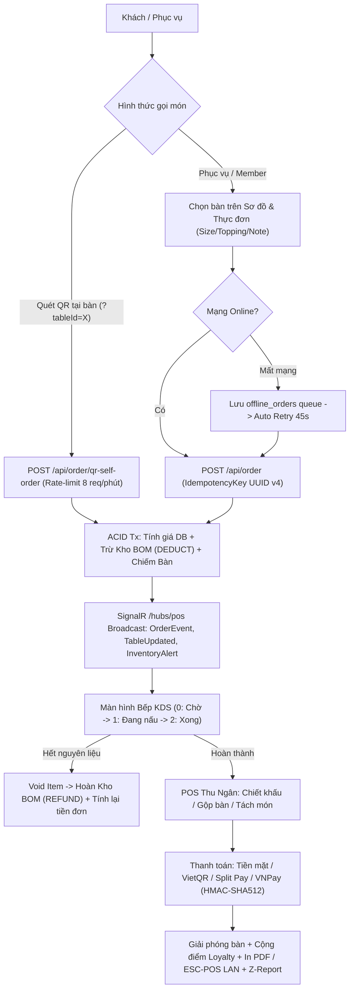

# HỆ THỐNG QUẢN LÝ NHÀ HÀNG & QUÁN CAFE (RESTAURANT & CAFE POS SYSTEM)

Giải pháp quản lý điểm bán hàng (**POS**), sơ đồ bàn ăn, điều phối bếp **KDS** thời gian thực (**SignalR**), quản lý kho định lượng nguyên liệu (**BOM**) và đặt món **QR Self-Order** đa nền tảng dành cho nhà hàng, quán cafe và chuỗi F&B. Hệ thống được xây dựng theo mô hình monorepo **Offline-Resilient**, gồm **Flutter Client** (Mobile Android, Web Browser, Windows Desktop), **ASP.NET Core 10 Web API + SignalR Hub**, và **Microsoft SQL Server** chuẩn hóa 3NF (18 bảng).

> **Tài liệu đọc nhanh & vấn đáp 1 người:** Xem thư mục [defense_guide/README.md](file:///d:/Download/restaurant_pos_app/defense_guide/README.md) (kèm 5 sơ đồ kiến trúc, ERD, RBAC, Sequence, Security định dạng SVG/PNG và kịch bản demo 5 phút).

---

## 1. TỔNG QUAN KIẾN TRÚC & NÂNG CẤP HOÀN THIỆN

Hệ thống vận hành theo kiến trúc phân lớp rõ ràng (**Controller / Hub → SiteProvider → Repository → EF Core 10**), kết hợp **Offline-First SQLite / Web Storage** và **SignalR WebSocket Push (`/hubs/pos`)**:

```
+---------------------------------------------------------------------------------------+
|                   FLUTTER CLIENT (Mobile Android / Web / Windows Desktop)              |
|  - UI Layer: FloorTableMap, CashierPos (Split/Merge), KDS Dark, AdminInventory,       |
|              RevenueAnalyticsPanel, MemberPortal, Guest QR Self-Order (?tableId=X)     |
|  - Services: PosRealtimeService (SignalR v1 WebSocket), OfflineSyncService (45s),     |
|              QrTableSession, ReceiptPrinterService (PDF + ESC/POS LAN TCP 9100)       |
|  - Local Persistence: SQLite (sqflite / sqflite_common_ffi) + Web SharedPreferences   |
+---------------------------------------------------------------------------------------+
                      |  RESTful JSON / Multipart + SignalR WebSocket (/hubs/pos)
                      v
+---------------------------------------------------------------------------------------+
|                ASP.NET CORE 10 WEB API + SIGNALR (Port 5138)                          |
|  - 12 API Controllers (Auth, Account, Category, Product, Table, Order,                |
|                        Kds, Payment, Shift, Discount, Loyalty, Inventory)             |
|  - Realtime: PosHub (/hubs/pos) + PosRealtimeNotifier (Order/KDS/Table/Inventory)     |
|  - Security: JWT HS256 RBAC, PBKDF2-SHA256 (100k iter), Gmail SMTP OTP, Strict CORS   |
|  - Data/Providers: SiteProvider + 9 Repositories + EF Core 10 (ACID Transactions)     |
+---------------------------------------------------------------------------------------+
                      |  Entity Framework Core 10 / ACID Transactions
                      v
+---------------------------------------------------------------------------------------+
|            MICROSOFT SQL SERVER EXPRESS (18 Tables - 3NF Normalized)                  |
|  Roles, Accounts, Areas, DiningTables, Categories, Products, ProductAttributes,       |
|  Orders, OrderDetails, OrderDetailModifiers, Shifts, Payments, Reservations,          |
|  Discounts, LoyaltyTransactions, Ingredients, ProductRecipes, StockTransactions       |
+---------------------------------------------------------------------------------------+
```

### 6 Tính năng Nâng cấp Đã Triển khai Hoàn chỉnh
1. **Đồng bộ Thời gian Thực (SignalR `/hubs/pos`)**: [PosHub.cs](file:///d:/Download/restaurant_pos_app/backend/Hubs/PosHub.cs) + [realtime_service.dart](file:///d:/Download/restaurant_pos_app/mobile/lib/services/realtime_service.dart) đẩy tức thì sự kiện `OrderEvent`, `KdsUpdated`, `TableUpdated`, `InventoryAlert` giữa Phục vụ – Bếp KDS – Thu ngân – Kho.
2. **Quản lý Kho & Định lượng Nguyên liệu (BOM / Recipe)**: Thêm 3 bảng (`Ingredients`, `ProductRecipes`, `StockTransactions`), API [InventoryController.cs](file:///d:/Download/restaurant_pos_app/backend/Api/Controllers/InventoryController.cs), tự động trừ kho `DEDUCT` khi tạo/thêm món & hoàn kho `REFUND` khi void món trong [OrderRepository.cs](file:///d:/Download/restaurant_pos_app/backend/Models/OrderRepository.cs), cùng màn hình quản trị [admin_inventory_page.dart](file:///d:/Download/restaurant_pos_app/mobile/lib/views/admin/admin_inventory_page.dart).
3. **UI Gộp bàn & Tách món Trực quan trên Thu ngân POS**: Modal chọn bàn đích để gộp (`_showMergeTableModal`) và chọn từng món/bàn mới để tách đơn (`_showSplitTableModal`) ngay trên [cashier_pos_terminal_page.dart](file:///d:/Download/restaurant_pos_app/mobile/lib/views/cashier/cashier_pos_terminal_page.dart) và [floor_table_page.dart](file:///d:/Download/restaurant_pos_app/mobile/lib/views/table/floor_table_page.dart).
4. **Biểu đồ Doanh thu Trực quan & Xuất CSV Kế toán**: Endpoint `GET /api/order/analytics?days=7` và `GET /api/order/export-csv` (UTF-8 BOM), hiển thị bằng [revenue_charts.dart](file:///d:/Download/restaurant_pos_app/mobile/lib/widgets/revenue_charts.dart) trên [admin_order_list_page.dart](file:///d:/Download/restaurant_pos_app/mobile/lib/views/admin/admin_order_list_page.dart).
5. **In Bill Nhiệt ESC/POS 80mm Qua Mạng LAN (TCP 9100)**: [escpos_printer_service.dart](file:///d:/Download/restaurant_pos_app/mobile/lib/services/escpos_printer_service.dart) (hỗ trợ TCP Socket trên Desktop/Android + stub an toàn trên Web, lọc dấu tiếng Việt & lệnh cắt giấy ESC/POS) tích hợp vào nút **In LAN** trong [receipt_printer_service.dart](file:///d:/Download/restaurant_pos_app/mobile/lib/services/receipt_printer_service.dart).
6. **QR Self-Order Tại Bàn Cho Thực Khách**: Quét URL `/?tableId=X` ([qr_table_session.dart](file:///d:/Download/restaurant_pos_app/mobile/lib/services/qr_table_session.dart)), hiện banner bàn QR ở [home_page.dart](file:///d:/Download/restaurant_pos_app/mobile/lib/views/home_page.dart) và gọi endpoint `[AllowAnonymous] POST /api/order/qr-self-order` có rate-limit chống spam (8 req/phút, trả HTTP 429 khi vượt ngưỡng).

---

## 2. CÔNG NGHỆ SỬ DỤNG (TECHNOLOGY STACK)

| Thành phần | Công nghệ | Phiên bản / Chi tiết | Mục đích sử dụng |
| :--- | :--- | :--- | :--- |
| Multi-Platform Client | Flutter / Dart SDK | Flutter 3.x / Dart 3.x | Mobile Android, Web Chrome & Windows Desktop (`restaurant_pos_app.exe`) |
| Realtime WebSocket | `web_socket_channel` + SignalR | Protocol JSON v1 (`/hubs/pos`) | Push cập nhật đơn hàng, trạng thái bếp KDS, bàn ăn & cảnh báo tồn kho |
| Local Persistence | `sqflite` + `sqflite_common_ffi` + `shared_preferences` | Desktop FFI + Web storage | Lưu session, giỏ hàng phân biến thể & hàng đợi offline (`IdempotencyKey`) |
| Backend API | ASP.NET Core Web API | .NET 10.0 (`net10.0`) | 12 REST Controllers + `PosHub`, JWT HS256, PBKDF2-SHA256, SMTP OTP |
| ORM & Database | Entity Framework Core + SQL Server | EF Core 10 + SQL Server Express | 18 bảng chuẩn 3NF, Filtered Unique Index, giao dịch ACID BOM & Payment |
| Thanh toán & In ấn | VietQR / VNPay / PDF + ESC/POS | NAPAS 247, HMAC-SHA512, TCP 9100 | Thanh toán Tiền mặt, VietQR động, Split Pay, VNPay Sandbox & In nhiệt LAN |

---

## 3. SƠ ĐỒ LUỒNG NGHIỆP VỤ & KIẾN TRÚC



---

## 4. DANH SÁCH TÀI KHOẢN THEO VAI TRÒ (RBAC SEEDED ACCOUNTS)

Toàn bộ tài khoản khởi tạo trong [RestaurantPos_Acceptance.sql](file:///d:/Download/restaurant_pos_app/RestaurantPos_Acceptance.sql) đều dùng mật khẩu thử nghiệm mặc định là **`admin`** (lưu trong DB bằng PBKDF2 / auto-upgrade từ SHA-256 khi đăng nhập lần đầu):

| STT | Username | Mật khẩu | Role | Họ và tên | Email | Phạm vi nghiệp vụ |
| :---: | :--- | :---: | :--- | :--- | :--- | :--- |
| 1 | `admin` | `admin` | `ADMIN` | Nguyễn Văn Quản Trị | `admin@restaurantpos.vn` | Toàn quyền: Danh mục, Món, Kho BOM, Biểu đồ, CSV, Nhân sự RBAC |
| 2 | `manager01` | `admin` | `MANAGER` | Trần Thị Thu Quản Lý | `manager01@restaurantpos.vn` | Quản lý vận hành, Kho BOM, Thống kê đơn & Nhân sự cấp dưới |
| 3 | `cashier_mai` | `admin` | `CASHIER` | Lê Tuyết Mai | `mai.cashier@restaurantpos.vn` | POS Thu ngân Split-Screen, Gộp/Tách bàn, Chiết khấu, VietQR/VNPay/Split, Ca Z-Report, In LAN |
| 4 | `waiter_nam` | `admin` | `WAITER` | Phạm Hoàng Nam | `nam.waiter@restaurantpos.vn` | Sơ đồ 10 bàn, Mở/Chuyển/Gộp/Tách/Đặt bàn, Mã QR bàn, Hàng đợi Offline |
| 5 | `waiter_lan` | `admin` | `WAITER` | Đỗ Ngọc Lan | `lan.waiter@restaurantpos.vn` | Phục vụ bàn (kiểm thử thao tác đồng thời) |
| 6 | `kitchen` | `admin` | `KITCHEN` | Bếp Trưởng KDS | `kitchen@restaurantpos.vn` | KDS tiếp nhận món Realtime, Cập nhật `0→1→2`, Báo hết món, Hủy hoàn kho |
| 7 | `chef_dung` | `admin` | `HEAD_CHEF` | Ngô Tiến Dũng | `dung.chef@restaurantpos.vn` | Bếp trưởng chính: KDS Bếp/Bar, Gom món Batch Prep, Void món |
| 8 | `barista_tuan` | `admin` | `BARISTA_LEAD` | Vũ Anh Tuấn | `tuan.barista@restaurantpos.vn` | Quầy pha chế đồ uống |
| 9 | `member_khang` | `admin` | `MEMBER` | Bùi Vĩnh Khang | `khang.bui@gmail.com` | Tích điểm (`1.250 PTS`), Đổi voucher, Tự gọi món QR, Tra cứu đơn |
| 10 | `vip_huong` | `admin` | `VIP_MEMBER` | Đặng Thu Hương | `huong.dang@fpt.com` | Hội viên VIP (`2.800 PTS`) |
| 11 | `member_linh` | `admin` | `MEMBER` | Võ Diệu Linh | `linh.vo@outlook.com` | Hội viên liên kết OAuth |

---

## 5. DANH MỤC API CHÍNH (12 CONTROLLERS + SIGNALR HUB)

* **SignalR WebSocket**: `/hubs/pos` (`PosHub`) phát sự kiện `OrderEvent`, `KdsUpdated`, `TableUpdated`, `InventoryAlert`.
* **Auth & Account** ([AuthController.cs](file:///d:/Download/restaurant_pos_app/backend/Api/Controllers/AuthController.cs), [AccountController.cs](file:///d:/Download/restaurant_pos_app/backend/Api/Controllers/AccountController.cs)): `login`, `register`, `oauth-login` (chặn account hijack nội bộ), `request-otp` / `reset-password-otp` (Gmail SMTP thật, không lộ `devOtp`), `verify-email`, `profile/{id}`, `members`, `account/{id}/role`, `account/{id}/status`.
* **Catalog & Sold-Out** ([CategoryController.cs](file:///d:/Download/restaurant_pos_app/backend/Api/Controllers/CategoryController.cs), [ProductController.cs](file:///d:/Download/restaurant_pos_app/backend/Api/Controllers/ProductController.cs)): CRUD Danh mục & Món ăn, upload/xóa nhiều ảnh vào `wwwroot/images`, `PUT /api/product/{id}/toggle-availability`.
* **Floor & Tables** ([TableController.cs](file:///d:/Download/restaurant_pos_app/backend/Api/Controllers/TableController.cs)): CRUD Bàn/Khu vực, `status`, `transfer`, `merge`, `split`, `reserve`, `reservations`, `check-in`.
* **Orders, QR Self-Order & Analytics** ([OrderController.cs](file:///d:/Download/restaurant_pos_app/backend/Api/Controllers/OrderController.cs)): `POST /api/order` (`IdempotencyKey` + trừ kho BOM), `[AllowAnonymous] POST /api/order/qr-self-order` (rate-limit 8 req/phút), `add-items`, `void-item` (hoàn kho BOM), `by-table/{tableId}`, `discount`, `GET /api/order/analytics`, `GET /api/order/export-csv`.
* **Inventory & BOM** ([InventoryController.cs](file:///d:/Download/restaurant_pos_app/backend/Api/Controllers/InventoryController.cs)): `GET/POST/PUT /api/inventory/ingredients`, `POST /api/inventory/ingredients/{id}/adjust`, `GET/PUT /api/inventory/recipes/{productId}`, `GET /api/inventory/transactions`.
* **KDS, Payment, Shift, Discount, Loyalty**: [KdsController.cs](file:///d:/Download/restaurant_pos_app/backend/Api/Controllers/KdsController.cs) (`active-orders`, `{id}/status`, `{id}/void`), [PaymentController.cs](file:///d:/Download/restaurant_pos_app/backend/Api/Controllers/PaymentController.cs) (`confirm`, `cash`, `vietqr/{orderId}`, `vnpay/create-url`, `vnpay/callback`), [ShiftController.cs](file:///d:/Download/restaurant_pos_app/backend/Api/Controllers/ShiftController.cs) (`current`, `open`, `close`, `{id}/z-report`), [DiscountController.cs](file:///d:/Download/restaurant_pos_app/backend/Api/Controllers/DiscountController.cs), [LoyaltyController.cs](file:///d:/Download/restaurant_pos_app/backend/Api/Controllers/LoyaltyController.cs) (`me`, `redeem`).

---

## 6. HƯỚNG DẪN CÀI ĐẶT & CHẠY HỆ THỐNG

### 6.1. Bước 1: Khởi tạo SQL Server (18 Bảng)
Chạy file [RestaurantPos_Acceptance.sql](file:///d:/Download/restaurant_pos_app/RestaurantPos_Acceptance.sql) (hoặc [RestaurantPosDb.sql](file:///d:/Download/restaurant_pos_app/RestaurantPosDb.sql)) trên SQL Server / SQL Express:
```powershell
sqlcmd -S .\SQLEXPRESS -E -C -i RestaurantPos_Acceptance.sql
```

### 6.2. Bước 2: Thiết lập `.env` & Chạy Backend (.NET 10 + SignalR)
```powershell
cd backend
Copy-Item .env.example .env
# Cập nhật ConnectionStrings__RestaurantPosDb, Jwt__Key, SMTP & VNPay nếu cần trong .env
dotnet restore
dotnet build WebApi.csproj
dotnet run --urls "http://localhost:5138"
```
> **Lưu ý bảo mật:** File `backend/.env` đã được đưa vào `.gitignore`. Tuyệt đối không commit secret lên Git.

### 6.3. Bước 3: Thiết lập `.env` & Chạy Flutter Client
```powershell
cd ..\mobile
Copy-Item .env.example .env
flutter pub get

# Chạy trên Windows Desktop:
flutter run -d windows

# Chạy trên Web Chrome (hỗ trợ test ?tableId=2 cho QR Self-Order):
flutter run -d chrome --web-port 8088

# Chạy trên Android Emulator/Device:
flutter run
```

---

## 7. KIỂM THỬ CHẤT LƯỢNG (QUALITY GATES)

```powershell
# 1. Biên dịch Backend
cd backend; dotnet build WebApi.csproj

# 2. Phân tích tĩnh & Unit/Widget/E2E Tests (89/89 Pass)
cd ..\mobile; flutter analyze --no-fatal-infos; flutter test -j 1

# 3. Build kiểm chứng Web & Windows Desktop
flutter build web; flutter build windows

# 4. Live QA Toàn bộ Vai trò (API + SignalR WebSocket + BOM DB + Playwright Chrome Mobile & Desktop)
cd ..; python scripts/run_strict_qa_all_roles.py
```

---

## 8. CẤU TRÚC THƯ MỤC DỰ ÁN

```
restaurant_pos_app/
+-- RestaurantPosDb.sql                       # Schema 18 bảng SQL Server + Seed đầy đủ
+-- RestaurantPos_Acceptance.sql              # Schema 18 bảng + Seed kiểm thử (kitchen, member_khang, 12 nguyên liệu BOM...)
+-- README.md                                 # Tài liệu kỹ thuật tổng quan dự án
+-- defense_guide/                            # Bộ tài liệu & 5 biểu đồ SVG/PNG phục vụ vấn đáp 1 người
|   +-- README.md, 01..05_*.md
|   +-- diagrams/                             # 01_system_architecture, 02_erd_database, 03_rbac, 04_sequence, 05_auth
+-- backend/                                  # ASP.NET Core 10 Web API + SignalR
|   +-- Api/Controllers/                      # 12 Controllers + BaseController
|   +-- Hubs/PosHub.cs                        # SignalR Hub (/hubs/pos)
|   +-- Models/                               # RestaurantPosContext (18 DbSets), SiteProvider, 9 Repositories, DTOs
|   +-- Services/                             # PasswordHasher (PBKDF2), JwtTokenService, EmailService, PosRealtimeNotifier, Helper
|   +-- wwwroot/images/                       # Ảnh danh mục & món ăn tĩnh
+-- mobile/                                   # Flutter Client (Android / Web / Windows Desktop)
|   +-- lib/models/, lib/repositories/, lib/widgets/revenue_charts.dart
|   +-- lib/services/                         # realtime_service, offline_sync_service, qr_table_session, receipt/escpos_printer
|   +-- lib/views/                            # admin/ (kể cả AdminInventoryPage), cashier/, kitchen/, table/, member/, auth/, order/
|   +-- test/                                 # 13 test files (89 test cases)
+-- scripts/
    +-- run_strict_qa_all_roles.py            # Bộ Live QA E2E (API + SignalR + BOM + Playwright Chrome Mobile & Desktop)
```
