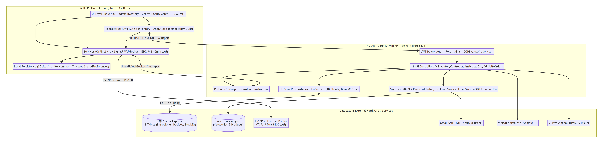
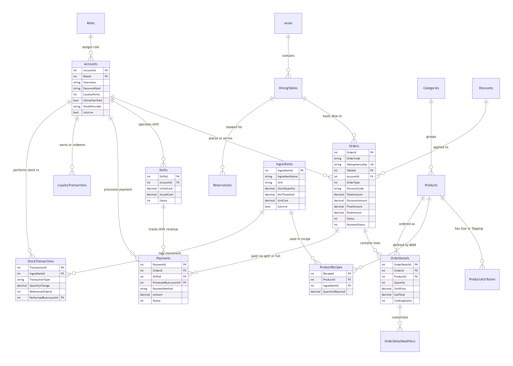
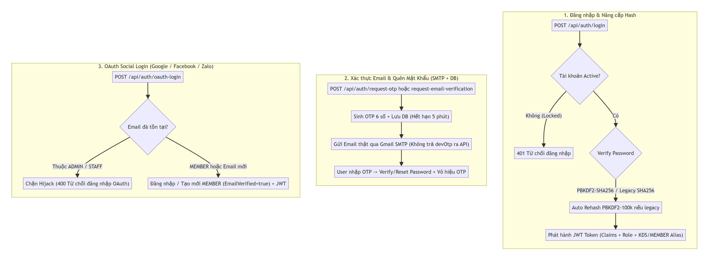
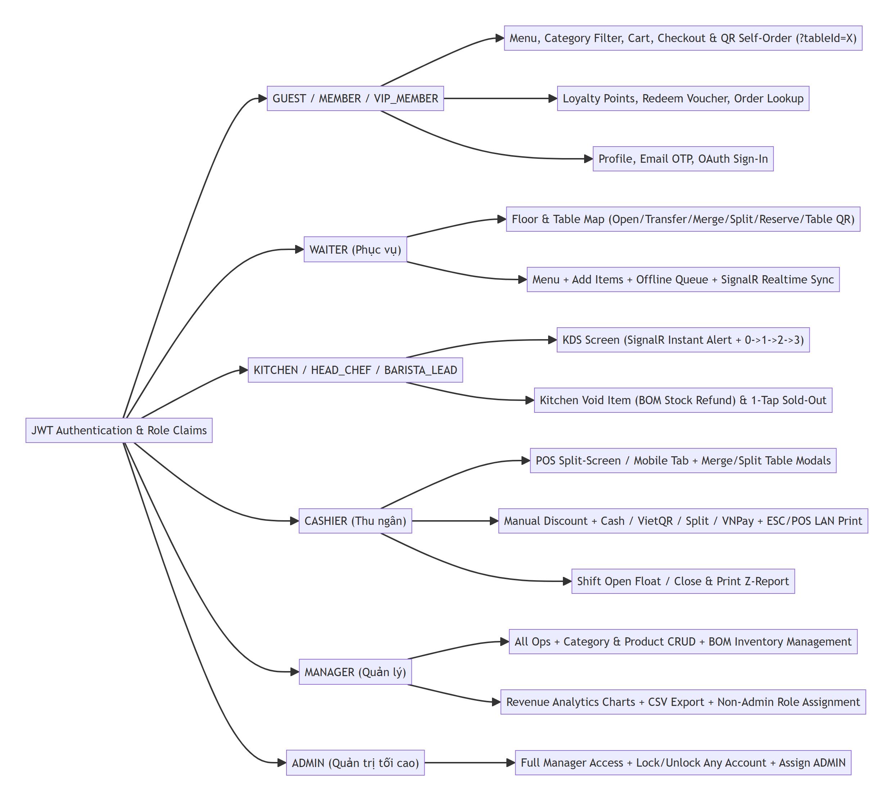
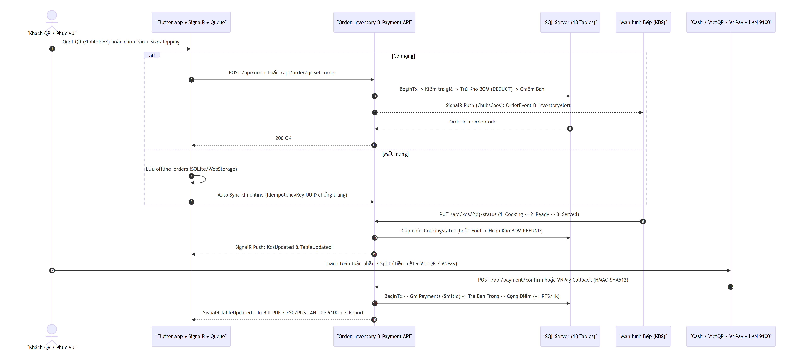

# 01 — Tổng Quan Kiến Trúc & Cơ Sở Dữ Liệu

## 1. Kiến trúc tổng thể 3 tầng (Multi-Platform Client + ASP.NET Core 10 + SQL Server)

### Điểm nhấn kỹ thuật của từng tầng
1. **Presentation Layer (Flutter 3 / Dart — 1 codebase chạy 3 nền tảng):**
   - **Mobile (Android)**: Giao tiếp backend qua `http://10.0.2.2:5138`, lưu offline bằng `SQLite` (`sqflite`).
   - **Web (Chrome)**: Tự động chuyển endpoint về `http://localhost:5138`, lưu phiên & hàng đợi vào `SharedPreferences` (`localStorage`).
   - **Windows Desktop**: Khởi tạo `sqfliteFfiInit()` + `databaseFactoryFfi` trong [database_helper.dart](file:///d:/Download/restaurant_pos_app/mobile/lib/utils/database_helper.dart) để dùng file SQLite cục bộ thực thụ.
   - **Role-Based Adaptive UI**: Thanh điều hướng dưới cùng (`NavigationBar` trong [main.dart](file:///d:/Download/restaurant_pos_app/mobile/lib/main.dart)) và layout màn hình (ví dụ Thu ngân dùng Split-Screen trên Desktop ≥ 900px, Tabbed 2 cột trên Mobile) tự biến đổi theo vai trò & kích thước màn hình, kèm Route Guard (`onGenerateRoute`) chặn truy cập trái phép ngay ở tầng UI.

2. **Application / API Layer (ASP.NET Core 10 Web API + SignalR):**
   - Tổ chức theo **Provider / Repository Pattern** ([SiteProvider.cs](file:///d:/Download/restaurant_pos_app/backend/Models/SiteProvider.cs) + 9 Repository chuyên biệt kể cả `InventoryRepository`) kết hợp **EF Core 10** ([RestaurantPosContext.cs](file:///d:/Download/restaurant_pos_app/backend/Models/RestaurantPosContext.cs)).
   - **Realtime WebSocket (`/hubs/pos`)**: [PosHub.cs](file:///d:/Download/restaurant_pos_app/backend/Hubs/PosHub.cs) + [PosRealtimeNotifier.cs](file:///d:/Download/restaurant_pos_app/backend/Services/PosRealtimeNotifier.cs) đẩy sự kiện `OrderEvent`, `KdsUpdated`, `TableUpdated`, `InventoryAlert` theo thời gian thực tới mọi client đang mở; trên Flutter kết nối qua [realtime_service.dart](file:///d:/Download/restaurant_pos_app/mobile/lib/services/realtime_service.dart).
   - **Fail-safe & Global Exception Handler**: Toàn bộ exception nội bộ được chặn qua middleware ở [Program.cs](file:///d:/Download/restaurant_pos_app/backend/Program.cs), tuyệt đối không lộ stack trace hay chuỗi kết nối ra client.
   - **12 Controllers RESTful**: tách rõ nghiệp vụ (`Auth`, `Account`, `Category`, `Product`, `Table`, `Order`, `Kds`, `Payment`, `Shift`, `Discount`, `Loyalty`, `Inventory`).

3. **Data & Integration Layer:**
   - **SQL Server Express (`RestaurantPos_Acceptance`)**: 18 bảng chuẩn 3NF (`10 Areas`, `10 DiningTables`, `10 Categories`, `34 Products`, `11 Roles`, `11 Accounts`, `12 Ingredients`, `24 ProductRecipes`, `3 StockTransactions`).
   - **Tích hợp phần cứng & dịch vụ thực**: Gmail SMTP (OTP xác thực email & khôi phục mật khẩu), **VietQR NAPAS 247**, **VNPay Sandbox** (HMAC-SHA512), và **Máy in nhiệt ESC/POS 80mm qua TCP/IP cổng 9100** ([escpos_printer_service.dart](file:///d:/Download/restaurant_pos_app/mobile/lib/services/escpos_printer_service.dart)).

---

## 2. Cơ sở dữ liệu 18 bảng (3NF) & Ràng buộc toàn vẹn

### Các quyết định thiết kế DB ăn điểm khi vấn đáp
- **Quản lý kho theo định lượng BOM (`Ingredients`, `ProductRecipes`, `StockTransactions`)**: Khi tạo đơn hoặc gọi thêm món, `OrderRepository` tự động trừ `Ingredients.CurrentStock` và ghi log `DEDUCT`; khi bếp/thu ngân hủy món (`void-item` / `kds/void`), hệ thống hoàn kho (`REFUND`); nguyên liệu tụt xuống `<= MinThreshold` sẽ kích hoạt `InventoryAlert` realtime qua SignalR.
- **Tách `OrderDetails` + `OrderDetailModifiers`**: Giá món và topping tại thời điểm đặt được snapshot vào `UnitPrice`, `SubTotal`, `ExtraPrice` nên khi Admin sửa giá món trong tương lai, lịch sử hóa đơn cũ không bị sai lệch.
- **Khóa chống trùng đơn `UX_Orders_IdempotencyKey`**: Filtered Unique Index trên `Orders(IdempotencyKey) WHERE IdempotencyKey IS NOT NULL` ngăn chặn triệt để tình trạng double-order do mạng chập chờn hoặc người dùng bấm đúp.
- **Dòng đời trạng thái đa tầng**:
  - `DiningTables.Status`: `0` (Trống) · `1` (Có khách) · `2` (Chờ phục vụ) · `3` (Đã đặt trước).
  - `OrderDetails.CookingStatus`: `0` (Chờ nấu) · `1` (Đang làm) · `2` (Đã xong) · `3` (Đã giao món) · `4` (Đã hủy/Void).
  - `Orders.Status`: `0` (Đơn mới) · `1` (Đang chế biến) · `2` (Đã phục vụ) · `3` (Hoàn thành) · `4` (Đã hủy).
- **Đối soát ca thu ngân (`Shifts` ↔ `Payments`)**: Mỗi giao dịch thanh toán gắn với `ShiftId` đang mở và `ProcessedByAccountId`, cho phép kết xuất báo cáo **Z-Report** đối chiếu tiền mặt kỳ vọng (`InitialCash + TotalSalesCash`) với tiền thực đếm trong két (`ActualCash`).

---

## 3. Luồng bảo mật & Phân quyền RBAC

- **Chống lộ thông tin nhạy cảm**:
  - Endpoint quên mật khẩu / xác thực email gửi OTP thật qua SMTP và lưu hạn 5 phút trong DB — **không trả `devOtp` trong response**.
  - `backend/.env` chứa secret (JWT Key, DB Connection String, SMTP App Password, VNPay HashSecret) bị `.gitignore` chặn hoàn toàn khỏi Git.
- **Chống Account Hijack qua OAuth**: Khi đăng nhập Google/Facebook/Zalo, nếu email đã thuộc tài khoản `ADMIN` hoặc `STAFF`, hệ thống **từ chối nâng quyền qua OAuth** để bảo vệ tài khoản vận hành nội bộ.

---

## 4. Chu trình nghiệp vụ End-to-End (Gọi món → KDS → Thanh toán)

