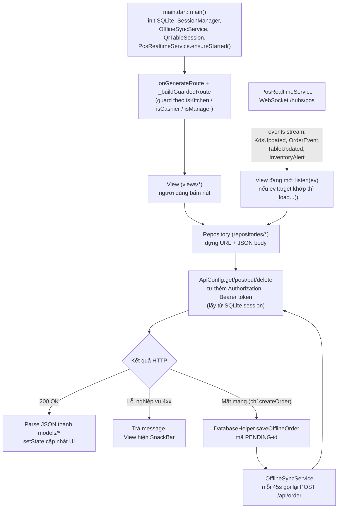
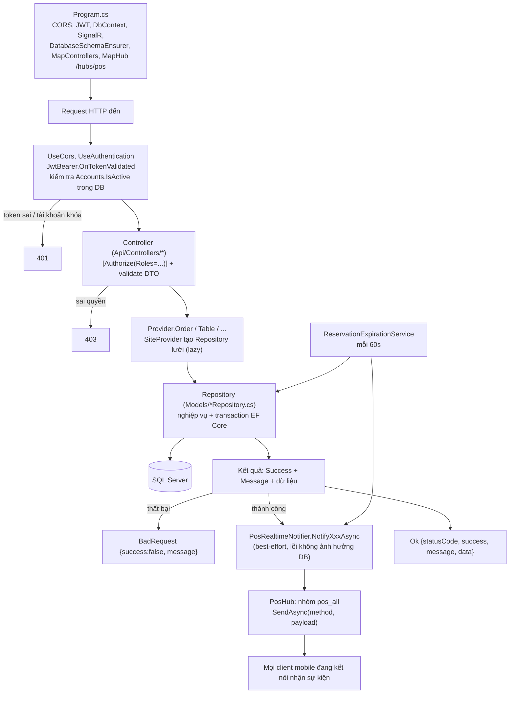
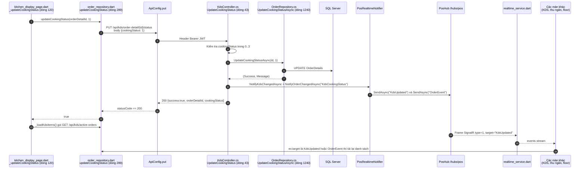
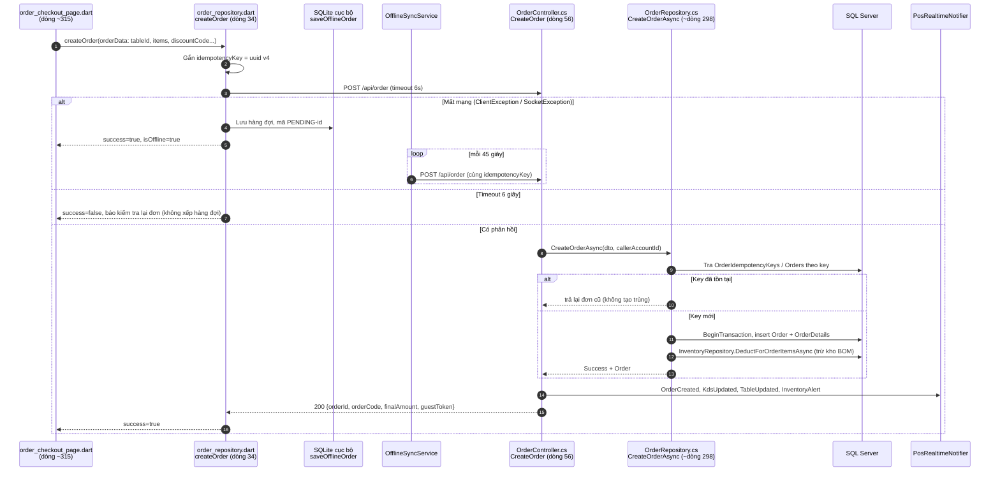
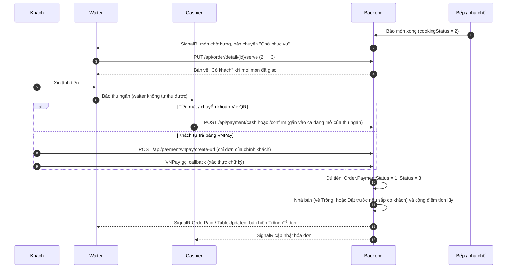

# Luồng hoạt động chung: Mobile và Backend

Quy ước chung: mọi tính năng đi theo cùng một khuôn.

- **Mobile**: View → Repository → `ApiConfig` (gắn JWT) → HTTP.
- **Backend**: Controller (`[Authorize]`) → `Provider.X` (Repository) → EF Core/SQL Server → `PosRealtimeNotifier` → SignalR.
- **Quay lại mobile**: `PosRealtimeService.events` → View nghe sự kiện → gọi lại Repository để tải dữ liệu mới.

## 1. Luồng chung phía Mobile

## 2. Luồng chung phía Backend

## 3. Ví dụ cụ thể 1: Bếp bấm "Đang nấu" cho một món (KDS)

Đây là ví dụ ngắn nhất, đủ cả hai chiều: gọi API và nhận realtime.

## 4. Ví dụ cụ thể 2: Tạo đơn hàng (có offline và chống trùng)

## 5. Cách suy ngược sang ví dụ khác

Khi có một tính năng mới, thay các ô theo bảng sau. Ví dụ bên dưới là "Thu ngân xác nhận thanh toán tiền mặt".

| Bước | Cách tìm trong code | Ví dụ KDS | Ví dụ thanh toán |
|---|---|---|---|
| 1. View | Tìm nút bấm trong `views/*` | `kitchen_display_page.dart` → `_updateCookingStatus` | `cashier_pos_terminal_page.dart` |
| 2. Repository mobile | Tìm hàm có URL tương ứng trong `repositories/*` | `OrderRepository.updateCookingStatus` | `OrderRepository.confirmPayment` (dòng 325) |
| 3. Endpoint | Đọc dòng `Uri.parse('$xxxBaseUrl/...')` | `PUT /api/kds/order-detail/{id}/status` | `POST /api/payment/confirm` |
| 4. Controller | Tìm `[HttpXxx("...")]` khớp trong `Api/Controllers/*` | `KdsController.UpdateCookingStatus` | `PaymentController` (`[HttpPost("confirm")]`, dòng 70) |
| 5. Quyền | Xem `[Authorize(Roles=...)]` | Nhóm vai trò của KdsController | Thu ngân, quản lý |
| 6. Nghiệp vụ | Tìm `Provider.X.Y(...)` trong controller | `Provider.Order.UpdateCookingStatusAsync` | `Provider.Payment...` trong `PaymentRepository.cs` |
| 7. Realtime | Tìm `_realtime.NotifyXxx` trong controller | `KdsUpdated`, `OrderEvent` | Các `Notify...` sau khi thanh toán |
| 8. Nhận ở mobile | Tìm `events.listen` trong view | Màn KDS gọi `_loadKdsItems` | Màn floor và thu ngân tải lại |

Các bước tìm nhanh:

1. Từ nút trên giao diện, tìm Repository mobile và đọc dòng URL.
2. Tìm đúng chuỗi route đó trong `backend/Api/Controllers`. Route backend là `api/[controller]` cộng với `[HttpXxx("...")]`.
3. Đọc dòng `Provider.<Tên>.<Hàm>` để biết file repository nào xử lý nghiệp vụ.
4. Đọc các dòng `_realtime.Notify...` để biết sự kiện nào được phát.
5. Tìm tên sự kiện đó trong `views/*` (`ev.target == '...'`) để biết màn nào tự cập nhật.

Lưu ý khi đọc code: các sự kiện phát ra có 4 tên thực tế là `OrderEvent`, `KdsUpdated`, `TableUpdated` và `InventoryAlert` (`PosRealtimeNotifier.cs`).

## 6. Quan hệ thanh toán giữa khách, phục vụ (waiter) và thu ngân (cashier)

### 6.1 Ai được làm gì

| Việc | Khách / hội viên | Waiter | Cashier | Manager / Admin |
|---|---|---|---|---|
| Gọi món, tạo đơn | Có (đơn của mình, hoặc QR tại bàn) | Có (qua menu bàn) | Có (POS thu ngân) | Có |
| Bếp báo xong món (0 → 2) | Không | Không | Không | Có (KDS) |
| **Xác nhận bưng món ra bàn (2 → 3)** | Không | **Có** | Có | Có |
| Lấy mã VietQR, tạo link VNPay cho đơn của mình | Có (chủ đơn hoặc có guest token) | Có | Có | Có |
| **Thu tiền mặt, xác nhận VietQR, tách thanh toán** (`/api/payment/cash`, `/confirm`) | Không | **Không (403)** | **Có** | Có |
| VNPay thanh toán xong (callback có chữ ký) | Tự động, không cần role | Không | Không | Không |
| Đặt trạng thái đơn 1 (Đang nấu), 2 (Đã phục vụ) | Không | Có | Có | Có |
| Đặt trạng thái đơn 3 (Hoàn thành), 4 (Hủy) | Không | **Không** | Có | Có |

### 6.2 Thứ tự chuẩn sau khi bưng món

### 6.3 Những điểm cần biết (đã đối chiếu với code)

1. **Đơn tại bàn chỉ được thu tiền khi mọi món đã giao ra bàn.** `ProcessPaymentAsync` ([PaymentRepository.cs](../backend/Models/PaymentRepository.cs)) từ chối thanh toán nếu còn món chờ nấu, đang nấu hoặc đã xong chờ bưng (mã lỗi `UNSERVED_ITEMS`). Quy tắc áp dụng cho thu tiền mặt, xác nhận VietQR, tách thanh toán và cả việc tạo link VNPay. Đơn mang về và giao hàng không bị chặn (thường trả trước hoặc trả khi nhận hàng). Món đã hủy không tính.
2. **Ngoại lệ do quản lý / admin.** App hỏi "Vẫn thu tiền?" và gửi lại với `allowUnserved = true`. Thu ngân và waiter không có quyền này. VNPay callback vẫn được xử lý vì tiền đã chuyển.
3. **VietQR không tự xác nhận.** Backend chỉ sinh mã QR, không có webhook ngân hàng. Thu ngân phải bấm xác nhận (`/api/payment/confirm`). Khách có thể quét mã nhưng đơn chỉ được tính là đã trả sau khi thu ngân xác nhận.
4. **VNPay là đường duy nhất tự đóng đơn mà không cần nhân viên.** Giao dịch gắn vào ca của thu ngân nếu có đúng một ca đang mở, ngược lại không gắn ca nào.
5. **Waiter không đóng được đơn.** Muốn chuyển đơn sang "Hoàn thành" (3) thì đơn phải đã thanh toán, và chỉ ADMIN, MANAGER, CASHIER mới được đặt trạng thái này.
6. **Chỉ thanh toán đủ mới nhả bàn.** Trả một phần thì đơn và bàn vẫn mở.
7. **Mang về (thu ngân tạo đơn là thanh toán luôn):** thanh toán xong đơn **không đóng**. Đơn giữ trạng thái "đã thanh toán, chờ giao" và vẫn hiện trong POS (mục "Đơn đang chờ") cùng tiến độ từng món. Khi waiter xác nhận giao hết món (màn "Chờ bưng"), backend tự chuyển đơn sang Hoàn thành (`TryCompleteTakeawayAsync` trong [OrderRepository.cs](../backend/Models/OrderRepository.cs)). Nếu giao trước rồi mới trả tiền thì đơn hoàn tất ngay lúc thanh toán. Tiền của đơn nằm trong ca của thu ngân lúc thu; ca hiện tại và Z-Report ghi thêm số đơn mang về, đã giao và còn chờ giao.
8. **Giao hàng:** không có bàn, thu tiền khi giao (COD) hoặc trả trước; đơn đóng ngay khi thanh toán đủ như trước.
